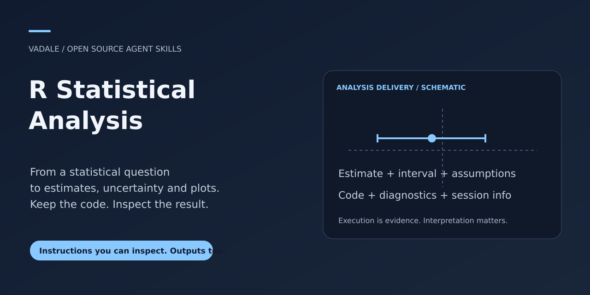
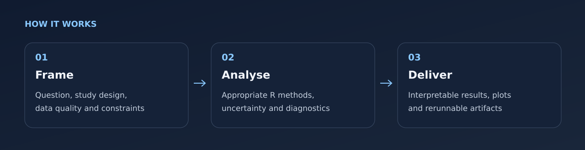
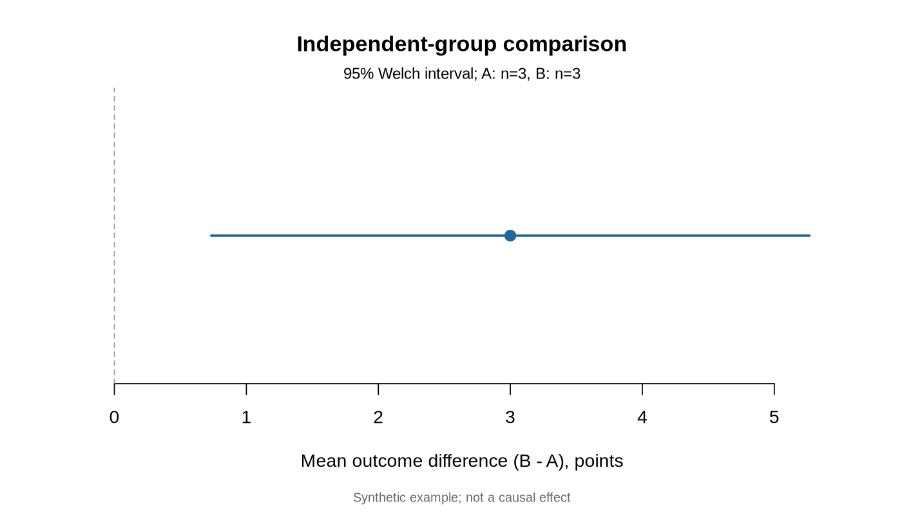

# R Statistical Analysis



[Checks](https://github.com/Vadale/r-statistical-analysis-skill/actions) · [Download](https://github.com/Vadale/r-statistical-analysis-skill/releases) · [MIT](LICENSE-MIT) / [Apache 2.0](LICENSE-APACHE)

An assistant skill for turning statistical questions into executed R analysis,
interpretable estimates, uncertainty, diagnostics, plots and reproducible code.
It combines concise instructions with small R execution helpers. Ordinary work
requires neither relm nor a local language model, GPU or MCP server.

> Compare these independent groups, show the difference with uncertainty, and
> give me a plot and an analysis I can rerun.

The assistant inspects the design and data, selects appropriate R methods and
returns inspectable artifacts. Explicit language or notebook requirements take
precedence. This skill does not force R into an existing Python workflow.

## Install with skills.sh or Gemini CLI

Use the cross-agent installer and select your host:

```sh
npx skills add Vadale/r-statistical-analysis-skill --skill r-statistical-analysis
```

Or install the Gemini CLI extension from its packaged release:

```sh
gemini extensions install https://github.com/Vadale/r-statistical-analysis-skill
```

An existing R runtime and an authorized execution environment are required. The Gemini release ZIP exposes the canonical skill under `skills/`; the repository keeps its original `integrations/skills/` layout. The installer does not install R or statistical packages.

Restart the assistant session and confirm the skill is visible before use.
These packaging instructions do not establish full-workflow testing in every
client, automatic model selection or a gallery ranking.

## Try a natural request

Once this skill is installed and visible to your assistant, try:

> Compare groups A and B in this CSV. Each row is a different person; show the difference, uncertainty, a labelled plot and R code I can rerun.

A design-aware analysis with estimates, uncertainty, diagnostics, a useful plot and reproducible R code; missing data or methodological gaps stay visible.

See the [synthetic input/output example](examples/natural-request.md) for expected
behavior and nearby tasks that need another workflow. Automatic selection
depends on your host and model; explicit invocation remains available.

## Requirements and installation

For researchers, analysts and developers who need more than generated R code:
an executed analysis, an interpretable effect with uncertainty, and the artifacts
needed to inspect or rerun it. Suitable questions include group comparisons,
regression, repeated measures, survival and other statistical work; method-specific
packages and assumptions still need checking for each task.



In Codex, a short installation route is:

```text
$skill-installer install https://github.com/Vadale/r-statistical-analysis-skill/tree/main/integrations/skills/r-statistical-analysis
```

Or use the local helper below. Codex supports `~/.agents/skills/` for user skills;
confirm discovery and restart if necessary. See the
[official skill guide](https://developers.openai.com/codex/skills).

Use an authorized assistant with file/execution tools and an existing R runtime.
Python 3.9+ is needed for the optional installation helper and tests; R analyses
use only the packages justified by their method. The small demo uses base R.

Start from a reviewed copy of this repository. Choose an existing skill-directory
parent recognized by your assistant; the helper does not configure discovery or
modify your personal settings. Installation copies only this skill, refuses an
existing destination, and never installs R, models or R packages.

```sh
python integrations/assistant-tools.py doctor --package stats
python integrations/assistant-tools.py install /absolute/existing/skill-directory/r-statistical-analysis
python integrations/assistant-tools.py verify /absolute/existing/skill-directory/r-statistical-analysis
```

Start a fresh assistant session and confirm that it can access the skill. Ask a
question naturally, or explicitly request the installed `r-statistical-analysis`
skill using your host's invocation mechanism. Discovery and automatic selection
are host/model behavior, not a guarantee supplied by these files.

## Run the small demonstration

After installation, try a task with explicit design and outputs:

```text
Use $r-statistical-analysis on this CSV. Each row is a different person.
Compare groups A and B on outcome, report the difference and a 95% interval,
check relevant assumptions, and save a labelled plot plus code I can rerun.
Ask about design ambiguities before choosing the model.
```

From the repository root, choose a new output directory:

```sh
Rscript --vanilla integrations/skills/r-statistical-analysis/scripts/run-analysis.R \
  integrations/skills/r-statistical-analysis/scripts/example-independent.R \
  demo-output integrations/skills/r-statistical-analysis/assets/independent.csv
```

The synthetic independent-group example produces a labelled PDF, estimates,
diagnostics, retained warnings, code, input fingerprints and session information.
It uses a headless PDF device and explicit complete-case counts. Its tiny dataset
is for demonstrating the delivery contract, not an empirical study or a template
for paired, longitudinal or causal questions.



This PNG visualizes the estimate and interval computed by the included example.
It is a small synthetic delivery demonstration, not a research result or evidence
of a causal effect.

## What v0.2 adds

Analyses can declare required additional files through `required_artifacts`.
The runner refuses completion for missing, empty, directory, invalid or escaping
paths. The new example checks the runner's capability before analysing data;
older scripts continue to work with the new runner. See the
[output contract](integrations/skills/r-statistical-analysis/references/output-contract.md).

A runner completion establishes execution and contract checks, not full delivery
of every user requirement or scientific validity. The assistant still compares
actual files with the request and inspects their content. A nonempty file may be
the wrong plot. The runner executes trusted analyst code and is not a sandbox.
R computes locally, but a hosted assistant may receive excerpts, tool results and
plots; choose an authorized environment before processing private information.

## Checks and tested scope

Model-free checks need R and Python, with no model download or statistical-package
installation:

```sh
Rscript --vanilla tests/skills/r-statistical-analysis/test-runner.R .
python tests/assistant-integration/test-tools.py
python tests/skills/r-statistical-analysis/test-artifacts.py
```

The added tests include independent numerical references, missing denominators,
retained errors, one-way compatibility and negative artifact cases. Finite-value
checks reject NaN/Inf rather than accepting a vacuous tolerance comparison.
Numerical reproducibility is separate from byte-identical PDFs across systems.
The current development target is Linux x86_64/R 4.6.1; other runtimes, clients,
advanced methods and native discovery need their own evidence. Internal trials
are not customer validation or a statistical/security certification.

## Distribution and source

Create a new deterministic skill-only ZIP in an existing destination directory:

```sh
python integrations/assistant-tools.py bundle /absolute/existing/output/r-statistical-analysis.zip
```

This creates a local archive, not a marketplace submission. It includes only the
explicit skill payload and plugin metadata. Personal data, development logs,
planning and evaluation answers are not part of that payload.

Derived from the [R-ebirth companion skill](https://github.com/Vadale/R-ebirth).
See [NOTICE](NOTICE), [MIT license](LICENSE-MIT) and [Apache license](LICENSE-APACHE).
This is not the relm package and implies no R Foundation or upstream endorsement.

## Feedback and related skills

[Open an issue](https://github.com/Vadale/r-statistical-analysis-skill/issues) with a
small synthetic reproduction, expected behavior and your R/session details.
Do not attach confidential datasets or personal assistant conversations.
[Contribution guidance](CONTRIBUTING.md).

Related: [Sec-graph triage](https://github.com/Vadale/sec-graph-triage-skill) for reviewing
security-finding evidence; [AI Project Coach](https://github.com/Vadale/ai-project-coach-skill)
for improving how you work with AI. Each can be used independently.
